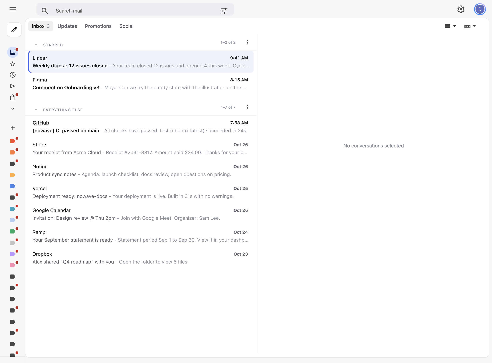

# nowave

[Shortwave](https://www.shortwave.com)'s keyboard flow and calm look for Gmail on the web, as one userscript. No AI.



## Why it exists

Shortwave made email fast with a few ideas: one key to mark a conversation done, a command palette, split inboxes, and a quiet interface. nowave brings those ideas to Gmail itself. Your mail stays in Gmail. There is no account to create, no subscription, and no AI. nowave makes no network requests and has no runtime dependencies. Its settings live in your browser's `localStorage`.

## Install

nowave is a userscript for `mail.google.com`. It must run at `document-start` in the page's own JavaScript world, which the script header asks for.

### Ardia

Clone this repository, then install the script:

```sh
ardia scripts install nowave.user.js
```

Ardia bundles `nowave.user.js` and its `src/` imports itself.

### Tampermonkey or Violentmonkey

1. Install [Tampermonkey](https://www.tampermonkey.net/) or [Violentmonkey](https://violentmonkey.github.io/).
2. Open [`dist/nowave.user.js`](https://raw.githubusercontent.com/dmnkf/nowave/main/dist/nowave.user.js). The extension offers to install it.
3. Reload Gmail.

In Chrome, Tampermonkey also needs **Allow User Scripts** turned on in its extension details. The extension checks the same URL for updates.

nowave was built and tested in Ardia, which is based on Chromium. It should run in Chrome, Arc, Edge, and Firefox through Tampermonkey or Violentmonkey, but nobody has tested that yet. Reports are welcome.

## Set up Gmail

nowave drives Gmail through Gmail's own keyboard shortcuts, so one setting is required:

- In Gmail, open **Settings > See all settings > General**, set **Keyboard shortcuts** to **Keyboard shortcuts on**, and click **Save Changes**. The palette command "Open Gmail keyboard shortcut setting" goes to that page.

These settings are optional but make Gmail feel more like Shortwave:

- **Vertical split pane.** Turn it on with the palette command "Toggle split view". Conversations then open beside the list.
- **Starred first.** In **Settings > Inbox**, set **Inbox type** to **Starred first**. Starred conversations then sit in their own section at the top, like Shortwave's pinned section.
- **Archive on both `d` and `e`.** Gmail archives only on a key you press yourself, and only on its own archive key (see [How it works](#how-it-works)). To make Shortwave's `d` archive too, turn on **Custom keyboard shortcuts** in **Settings > Advanced**, then set the two keys for **Archive** to `e` and `d` in the new **Keyboard Shortcuts** tab and save. nowave reads that tab when you open it, or when you run "Detect Gmail keyboard shortcuts" from the palette. Detection reads English labels only.

## Keys

Press `?` to see every command and its keys in the palette.

| Key | Action | Where |
| --- | --- | --- |
| `⌘K` or `Ctrl+K` | Command palette | Everywhere, also while typing |
| `e` or `d` | Mark done (archive) | List, thread |
| `⇧D` | Select everything in the view, also on later pages | List |
| `Esc` | Clear the selection after `⇧D` | List |
| `#` | Delete | List, thread |
| `!` | Report spam | List, thread |
| `m` | Mute | List, thread |
| `b` | Snooze | List, thread |
| `v` | Move to | List, thread |
| `u` | Toggle read and unread. In a thread, mark unread | List, thread |
| `⇧I`, `⇧U` | Mark as read, mark as unread | List, thread |
| `x` | Select conversation | List |
| `s` | Star | List, thread |
| `z` | Undo | List, thread |
| `j`, `k` | Next, previous conversation | List, thread |
| `l`, `o`, `Enter` | Open conversation | List |
| `h`, `Esc` | Back to the list, or close the reading pane | Thread, reading pane |
| `Tab`, `⇧Tab` | Next, previous split | List, thread |
| `g` then `1` to `9` | Go to split 1 to 9 | List, thread |
| `g` then `i`, `s`, `t`, `d` | Go to Inbox, Starred, Sent, Drafts | List, thread |
| `g` then `h` | Go to Snoozed | List, thread |
| `g` then `e` or `a` | Go to Done (All Mail) | List, thread |
| `g` then `!`, `#` | Go to Spam, Trash | List, thread |
| `/` | Search | List, thread |
| `c` | Compose | List, thread |
| `r`, `a`, `f` | Reply, reply all, forward | Thread |

`h` and `l` follow Shortwave's original vim-style navigation. In the list, the triage keys act on the conversation under the cursor, so you never have to select a row first. A selection you make yourself with `x` is kept.

The palette also has commands without a key: label a conversation, go to any label, switch between accounts 0 to 3, save or remove a split, toggle calm mode, toggle the Shortwave look, toggle Gmail's split view, and detect Gmail's keyboard shortcuts.

## Splits

The split tabs sit at the top of the thread list. Each split is a Gmail search, so a split shows exactly what that search would. The defaults are:

- Inbox (`in:inbox`), with Gmail's unread count in the Shortwave look.
- Updates (`in:inbox category:updates`).
- Promotions (`in:inbox category:promotions`).
- Social (`in:inbox category:social`).

To add a split, search for something and run "Save search as split…" from the palette. To remove one, run "Remove split: <name>".

## The Shortwave look

nowave restyles Gmail's light theme to look like Shortwave: a compact header, the navigation folded into an icon rail, rows without checkboxes, stars, or dividers, and a soft highlight on the cursor row. Calm mode, which is separate, hides Gemini buttons, the Google One upgrade link, and Gmail's category tabs while the split tabs show.

Both are on by default. To turn either off, run "Toggle Shortwave look" or "Toggle calm mode" from the palette.

## How it works

nowave runs at document start, before Gmail's own scripts, and listens for keys in the capture phase, so it sees every key first. For most actions it sends Gmail's own keyboard shortcut as a synthetic key event. For example, `b` in the list sends `x` to select the cursor row, then Gmail's `b`.

Gmail refuses to archive, delete, report spam, or mute on a synthetic key or a scripted click. It acts only when you press its key yourself. So nowave lets your real key through to Gmail, and in the list it selects the cursor row during that same key press. A key that is not Gmail's own for the action, such as `d` while Gmail archives only on `e`, shows a notice that names the key to press.

If you changed Gmail's shortcuts with custom keyboard shortcuts, nowave reads them from Gmail's **Keyboard Shortcuts** settings tab and sends your keys instead of Gmail's defaults.

## Limits

- Gmail does not document its DOM, and nowave depends on it. When Gmail changes, parts of nowave can break until the selectors are fixed. [docs/gmail-contract.md](docs/gmail-contract.md) lists every assumption and its evidence.
- Shortcut detection and a few selectors read English text, so they need Gmail in English. Everything else works in any language.
- The look styles Gmail's light theme only.
- That Gmail refuses synthetic delete, spam, and mute keys, like archive, is inferred and not checked, because checking changes mail.
- nowave is tested only in Ardia.

## Development

You need Node.js 22 or later.

```sh
npm ci
npm test
npm run build
```

`npm run build` bundles `nowave.user.js` and `src/` with esbuild into `dist/nowave.user.js` and keeps the userscript header at the top. Commit the rebuilt file with your change, because CI fails when `dist/` does not match the source.

The tests cover the modules that need no DOM: keys, routes, ranking, settings, the command registry, the action queue, and Gmail's shortcut notation. The palette, the real-key path, and the look need a real Gmail.

| File | Owns |
| --- | --- |
| `nowave.user.js` | Userscript header, settings persistence, the key listener, the sync loop |
| `src/commands.js` | The command registry that the key listener and the palette both read |
| `src/keys.js` | Chords, key sequences, synthetic key events, key labels |
| `src/gmail.js` | Every Gmail selector, key, and event trick |
| `src/skin.js` | The Shortwave look: its stylesheet, motion, and the selectors they use |
| `src/route.js` | URL hash to view and search query, split URLs |
| `src/settings.js` | Stored settings and the default splits |
| `src/palette.js` | Command palette UI |
| `src/splitbar.js` | Split tabs UI |
| `src/rank.js` | Fuzzy matching and palette groups |
| `src/queue.js` | The serial queue that triage actions run through |

### Check changes on a real Gmail

The scripts in `dev/` drive your own signed-in Gmail in its own Ardia window, through Ardia's command-line control. Turn on **Settings > Advanced > Command line** in Ardia first. They inject the bundle at document start and press only keys that leave mail unchanged.

- `dev/live.mjs` runs a set of live checks: selecting and unselecting a row, opening and cancelling snooze, the palette, splits, and the go-to keys. Leave its window visible while it runs, because Gmail pauses rendering in hidden pages.
- `dev/shot.mjs` takes screenshots after a list of steps, such as keys, waits, and scripts to run in the page. It uninstalls the installed nowave for the run and reinstalls the last commit afterwards.
- `dev/demo-inbox.js` replaces the mail on screen with demo content. Its header has the command that regenerates `docs/screenshot.png`.

```sh
npm run build
node dev/live.mjs dist/nowave.user.js
```

## License

[MIT](LICENSE)
